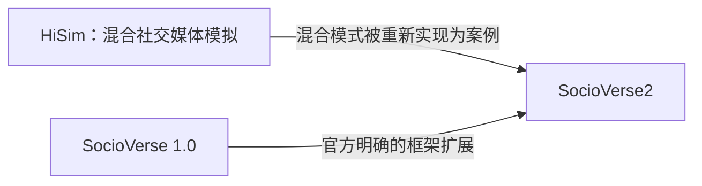
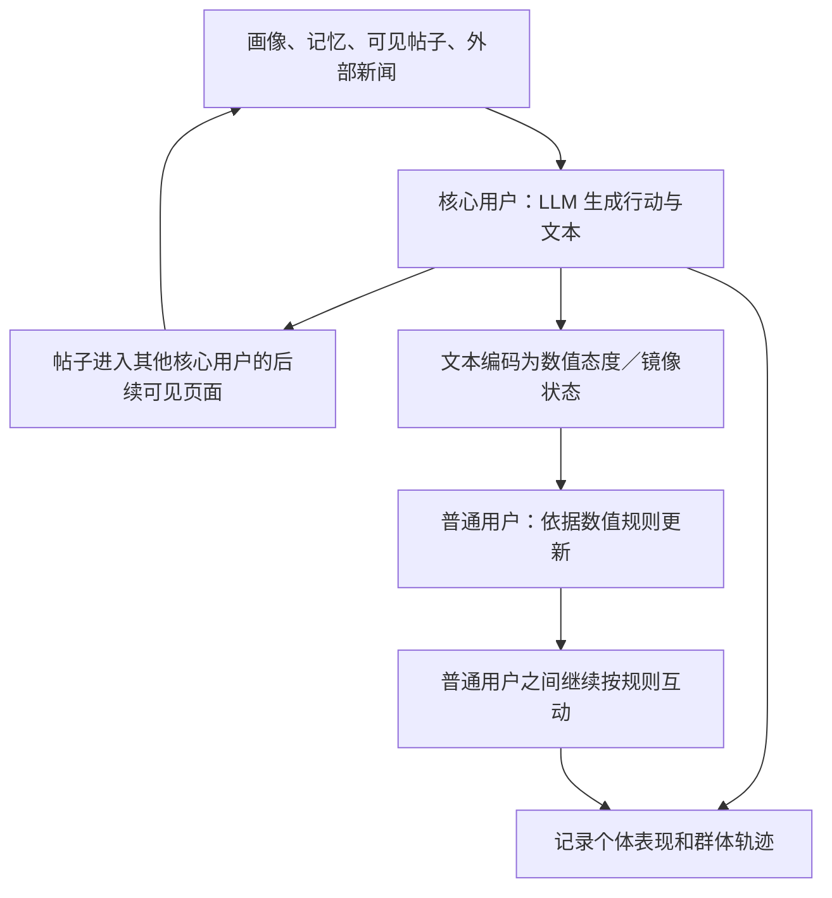
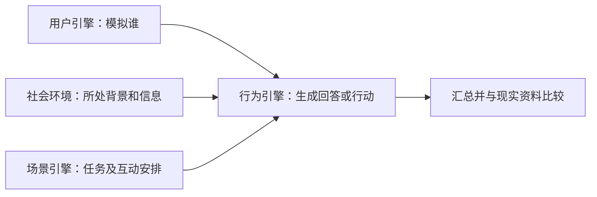
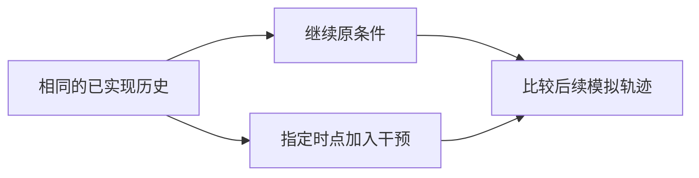

# HiSim、SocioVerse 1.0 与 SocioVerse2：架构拆解与社会科学评述

> 面向读者：希望理解 LLM 社会模拟、但不熟悉编程的社会科学研究者。  
> 整理日期：2026-10-13。文献范围：HiSim 2024 论文、SocioVerse 2025 v3、SocioVerse2 2026 v1，以及当日查阅的官方仓库和文档。  
> 文件性质：讨论总结与方法评述。本文区分作者的设计、公开实现说明和我们的评价；不修改本项目现行研究基准，不代表已经复现这三个框架。论文与网页所述功能不等同于本地运行验证，官方网页后续可能变化。

## 1. 三分钟读懂：三者究竟差在哪里

**HiSim 着重解决混合模拟的行为表达与计算成本；SocioVerse 1.0 着重组织人群、环境、场景和行为；SocioVerse2 着重管理连续模拟、干预比较与研究版本。** 这是对研究重心的归纳，不是三者性能优劣的实测排名。

| 读者要问的问题 | HiSim | SocioVerse 1.0 | SocioVerse2 |
| --- | --- | --- | --- |
| 它主要解决什么？ | 怎样用有限的 LLM 调用模拟较大的社交媒体群体？ | 怎样让不同研究共享人群与场景构造方法？ | 怎样持续跟踪同一批模拟人，并保存、修改和比较研究？ |
| 最有辨识度的设计 | 核心用户用 LLM，普通用户用规则 | 环境、用户、场景、行为四模块 | 两个循环：模拟逐轮运行，研究逐版本迭代 |
| 数量扮演什么角色？ | 扩大群体时控制成本 | 大资料池用于抽样、检索和画像 | 人数与轮次共同影响运行成本 |
| 如何接近现实？ | 使用真实用户资料、事件和行为记录 | 使目标人群、背景、互动方式相匹配 | 固定身份、动态环境、连续轨迹及数据来源记录 |
| 主要边界 | 混合连接和态度测量有假设 | 框架设想不等于全部实现；画像匹配不等于行为准确 | 运行可追踪不等于行为可信；模拟分支不等于现实因果实验 |

来源：[HiSim 论文](https://aclanthology.org/2024.findings-acl.285/)、[SocioVerse 1.0 论文](https://arxiv.org/html/2504.10157v3)、[SocioVerse2 官方仓库](https://github.com/sii-research/SocioVerse2)。

**阅读顺序：**只关心结论，读第 1、6、7 节；需要理解模块，读第 3—5 节；需要判断对本项目的价值，读第 8 节。文中“模块”指软件分工，不自动构成理论变量或经过验证的心理机制。

### 1.1 六个必要术语

| 术语 | 在本文中的含义 | 不应误解成什么 |
| --- | --- | --- |
| agent，代理或智能体 | 程序中的一个行动单位；在这些案例中常用来代表一个人 | 真实参与者，或已经具有真实人类心理的个体 |
| ABM，基于主体的建模 | 规定个体如何行动与互动，再观察群体结果 | 只能使用 LLM 的技术 |
| LLM agent | 使用大语言模型生成行动或回答的代理 | 模型说得通顺，就证明行为准确 |
| 环境 | 模型中提供的外部状态、信息及行动后果；具体范围随研究而变 | 必须有三维场景，或背景资料越多越好 |
| 校准与验证 | 校准用于调整模型；独立验证使用未参与调整的数据检查表现 | 在同一批数据上调得越像，证明就越充分 |
| 面板记录 | 同一个模拟对象在不同时间的多行记录 | 每轮重新生成一批互不对应的回答 |

这些是阅读说明，不是本文新提出的研究构念。尤其要区分“程序能正常运行”“符合某种规则”“能预测真人行为”三种不同的检查。

## 2. 三者是什么关系：有共同作者，但不是一条简单升级链

HiSim 的作者为 Xinyi Mou、Zhongyu Wei、Xuanjing Huang；三人也都参与了 SocioVerse 1.0 和 SocioVerse2。Xinyi Mou 是 HiSim 第一作者，Zhongyu Wei 是 HiSim 通讯作者，也是 SocioVerse2 的共同通讯作者之一。共同作者关系可以确认；个人在各代码模块中的贡献不能由署名次序推断。

来源：[HiSim 论文首页](https://aclanthology.org/2024.findings-acl.285.pdf)、[SocioVerse 1.0 作者名单](https://arxiv.org/abs/2504.10157)、[SocioVerse2 作者名单](https://arxiv.org/abs/2609.24911)。

SocioVerse2 明确以前一代 SocioVerse 为扩展起点，并在 `hisim_roe` 中重新实现 HiSim 的混合模式。因此，可以说它们属于有人员联系和方法继承的一组工作；不能把 SocioVerse2 整体称为“HiSim 2.0”，也不能仅凭架构相似认定代码被直接复制。[SocioVerse2 README](https://github.com/sii-research/SocioVerse2#companion-repositories)

## 3. HiSim：把两种模拟方式连接起来

### 3.1 研究对象和建模选择

HiSim 研究社交媒体事件中的用户行为与群体态度变化。其“核心用户／普通用户”是服务于模拟的分组：前者由 LLM 生成较复杂的文本行动，后者主要运行数值规则。它不是对两类人具有不同心理本质的证明。[原论文 §3](https://arxiv.org/html/2402.16333v2#S3)

### 3.2 模块拆解：输入什么，做什么，输出什么

下表依据原论文 §2—3 整理；最后一列是我们的审读问题。

| 模块或接口 | 输入 | 执行的工作与输出 | 社科读者需要追问 |
| --- | --- | --- | --- |
| 画像模块（Profile） | 个人简介、历史内容等 | 形成角色描述，供 LLM 使用 | 资料是观察得到，还是模型推断？ |
| 记忆模块（Memory） | 事件前个人记录、模拟中可见内容 | 写入、检索和归纳相关经历 | 被选入提示词的记录，是否真是当事人会记住的内容？ |
| 行动模块（Action） | 画像、记忆、页面和新闻 | 选择发帖、转发、回复、点赞或不行动 | 可选行为是否覆盖真实行为？ |
| 普通用户的状态与更新 | 初始态度、被选中的数值消息 | 按预设意见规则计算下一轮态度 | 规则和参数是否适合这一人群？ |
| 选择函数（selection） | 候选互动对象及模型设置 | 确定哪些对象的消息参与本轮更新 | 可到达、实际看见和接受影响是否被混为一谈？ |
| 消息函数（message） | 当前态度等状态 | 产生向他人传递的消息表示 | 公开表达是否等于内在态度？ |
| 更新函数（update） | 原态度、收到的消息 | 计算态度变化 | 单轮变化是否与真人相符？ |
| 文本到数值的连接 | 核心用户生成的文本 | 编码立场和强度，传入规则模型 | 文本情感强度能否代表议题态度强度？ |
| 社交媒体环境 | 关注关系、帖子、线下事件 | 提供时间线、通知与事件背景 | 每个用户看到的信息是否符合其实际条件？ |

原始模块和函数见：[HiSim §2—3](https://arxiv.org/html/2402.16333v2#S2)。其中“记忆”是程序组织历史输入的方式，不能仅凭名称认定它复现了人的认知过程。

### 3.3 一轮怎样运行

以下是便于阅读的功能关系图，不是逐行代码执行顺序。

原设计没有建模普通用户对核心用户的反向影响；核心用户与普通用户也不是全都通过相同的自然语言交流方式互动。后续移植文档把连接描述为镜像代理：核心用户在规则部分有对应状态，其值随文本编码结果更新。[原论文 §3.3](https://arxiv.org/html/2402.16333v2#S3.SS3)、[SocioVerse2 的 HiSim 案例说明](https://socioverse.fudan-disc.com/docs/examples/hisim-roe/)

### 3.4 如何验证，能说明什么

HiSim 同时检查真实上下文下的单轮行为，以及多轮模拟的群体统计与态度轨迹，并区分用于校准和用于验证的事件窗口。因此，不能把它描述成“只演示、完全没有验证”。但推文编码得到的态度不是直接观察到的内在意见；单轮表现与群体轨迹也不足以单独证明整个互动过程正确。[原论文 §4](https://arxiv.org/html/2402.16333v2#S4)

**我们的评述：**最值得借鉴的是将昂贵的文本行为与低成本规则连接，以及把信息选择、表达、更新分开讨论。需要重点核查的是分组依据、文本测量和单向连接。将部分用户交给规则，不代表这些用户的真实行为本来就简单。

## 4. SocioVerse 1.0：把研究场景拆成四个可复用部分

### 4.1 四模块分别承担什么

SocioVerse 1.0 使用四模块架构。下面的中文问题用于解释其分工；“引擎”可以直接理解为“负责某项工作的程序模块”。

| 原始模块名称 | 非技术问题 | 主要输入与处理 | 交给下一步的东西 |
| --- | --- | --- | --- |
| Social Environment，社会环境 | 当事人处于什么背景、能接触什么信息？ | 组织社会背景、事件与个性化内容 | 本次模拟可用的外部情境 |
| User Engine，用户引擎 | 模拟哪些人？ | 从用户资料中检索、描述目标对象 | 用户画像及相关历史 |
| Scenario Engine，场景引擎 | 这些人怎样参与研究或互动？ | 确定问卷、访谈、实验或社交互动结构，并按目标要求组织样本 | 问题、参与结构与互动设置 |
| Behavior Engine，行为引擎 | 这些人在当前条件下如何回应？ | 接收人群、情境与任务，调用行为模型 | 回答、选择或其他行动 |

来源：[SocioVerse 1.0 §2](https://arxiv.org/html/2504.10157v3#S2)。四模块属于架构设计；某种模块列入设计，不证明其所有功能已经在论文中实现。

### 4.2 “用户池”究竟意味着什么

用户池是构造模拟样本的资料来源。研究者需要从中检索或抽样，再决定模拟哪些对象；资料池规模不能直接当作同时运行的 agent 数量。画像中的部分属性来自内容推断，也不等于每项属性都经过本人确认。

**我们的评述：**这一路线减少了研究者凭空写人设的随意性，但没有消除样本来源偏差、属性推断误差和行为模型误差。这三个问题需要分开检查：人口构成相近，不保证每个人面对信息时会作出相近的反应。

### 4.3 设计范围与实证范围必须分开

论文的主要案例是选举预测、新闻反馈和经济调查。讨论部分明确说明，当时仅实现了完整框架的一部分，访谈和更自由的互动仍有扩展空间。因此，既不能把 1.0 说成“完全没有多轮互动设计”，也不能把所有设计场景写成已经成熟实现。[SocioVerse 1.0 §3 与 §5](https://arxiv.org/html/2504.10157v3)

**我们的评述：**它的推进重点是把模拟输入和场景组织得更系统。若要进一步主张行为更准确，应比较增加资料前后的独立预测表现，并报告哪些人群、哪些行为仍然预测不好。

## 5. SocioVerse2：把运行一次模型扩展为持续开展研究

### 5.1 两个循环，分别在改变什么

| 循环 | 每次推进什么 | 通俗解释 | 科学判断由谁承担 |
| --- | --- | --- | --- |
| 纵向模拟循环 | 时间、环境、agent 行动及状态 | 同一批模拟人经历后续事件 | 研究者定义行为和环境规则 |
| 可控研究循环 | 模型设计的版本 | 修改设计、另存版本、重新比较 | 研究者判断修改依据与结论 |

不要把“研究者和 AI 一起修改研究”误解成“被模拟的人与 AI 在社会中共同演化”。这是不同层面的过程。SocioVerse2 的研究循环首先是一种管理研究工作的方法。[官方概念总览](https://socioverse.fudan-disc.com/docs/)

### 5.2 四个运行接口：相当于四份职责说明

“接口”规定某个模块要交出什么结果，便于替换实现。它本身不决定行为理论。核心程序负责调度，具体研究提供下面四部分。

| 接口 | 白话职责 | 输入与输出 | 社科含义 |
| --- | --- | --- | --- |
| PopulationProvider | 建立模拟名册 | 人群资料与设置 → 带固定身份的 agent | 确定研究对象及初始构成 |
| EnvironmentProvider | 管理环境和每个人可见的部分 | 世界状态、时间与行动 → 观察信息及新状态 | 明确条件、信息暴露和行动后果 |
| DecisionModel | 根据观察作出行动 | 观察与记忆等 → 结构化行动 | 安放规则、LLM 或混合行为实现 |
| MetricCollector | 按预定口径计算指标 | 状态与行动 → 每轮统计 | 决定如何测量和报告结果 |

框架另提供运行循环、消息传递、记忆、记录和报告等共用功能。[官方架构文档](https://socioverse.fudan-disc.com/docs/concepts/architecture/)

**我们的评述：**职责分离使“替换行为模型而保持其他部分不变”更容易实现。但若某项研究把信息选择、表达和意见变化全部放进一次 LLM 调用，四接口本身不会替它解决过程混淆。

环境内部还使用两个分类维度：`physical / information` 区分状态与信息，`macro / local` 区分全局与面向个体的范围。它们是数据组织方式，不应直接上升为社会理论中的分析层级。

| 环境分类 | 全局（macro） | 局部（local） |
| --- | --- | --- |
| 状态（原文 physical） | 模型的全局状态 | 某个 agent 邻域的状态 |
| 信息（information） | 面向所有人的广播 | 只对指定 agent 可见的消息或信息流 |

这使“环境里存在什么”和“这个人得到什么”可以分开。`physical` 也不是指三维画面；其具体字段由研究实现规定。[官方概念说明](https://socioverse.fudan-disc.com/docs/concepts/overview/)

### 5.3 一步仿真中的五个阶段

初始化先保存每个 agent 的初始状态。随后，一步通常按下面的顺序推进；若配置了步内多次互动，则会重复观察、行动和应用结果。

| 阶段 | 程序在做什么 | 为什么值得社科研究者关心 |
| --- | --- | --- |
| 1. 外部更新 | 引入该时点的外部变化或干预 | 事件应在什么时间发生？ |
| 2. 观察 | 给每个 agent 提供其可见信息 | 不能默认所有人知道整个系统的一切 |
| 3. 决策 | 调用行为模型，生成行动 | 行为依赖哪些输入？ |
| 4. 应用 | 把行动造成的后果写回环境 | 发言怎样成为后续信息，行动怎样改变状态？ |
| 5. 记录 | 保存轨迹、记忆和指标 | 能否回查某个结果是怎样产生的？ |

来源：[官方运行循环文档](https://socioverse.fudan-disc.com/docs/concepts/simulation-loop/)。这里的“观察”是程序提供的信息，不自动等于现实中人的注意或理解；这些仍需研究设计规定。

### 5.4 支撑运行的其他模块

| 支撑部分 | 实际用途 | 容易被误解的地方 |
| --- | --- | --- |
| 人群数据服务 | 获取、抽样和组织用户资料 | 资料可能来自真实用户记录或合成人设；两者都不等于真实用户回答 |
| 事件数据服务 | 在建模时准备带时间信息的外部资料 | 限制检索时间，不等于消除 LLM 训练中已有的未来知识 |
| 工作流技能 | 辅助完成建模、人群、环境、运行、报告等步骤 | 生成了完整文件，不等于设计已经有效 |
| 数据与假设来源记录 | 记录哪些来自资料，哪些是建模假设 | 留有来源不等于该来源适合当前研究 |
| 轨迹存储 | 保存 agent、时间、状态、事件和指标等 | 模拟面板数据不是真实人的纵向调查数据 |

数据服务在准备研究时生成相应文件；它们与核心运行包分离。官方说明相关服务部署在服务端，需要相应访问条件，因此“仓库开源”不等于所有人群资料与服务都可以直接下载复现。[数据服务](https://socioverse.fudan-disc.com/docs/guides/data-services/)、[来源记录](https://socioverse.fudan-disc.com/docs/guides/grounding-and-capabilities/)、[架构](https://socioverse.fudan-disc.com/docs/concepts/architecture/)

表中关于注意、理解、训练知识和数据适用性的提示，是我们的验证要求，不是声称已经发现该平台发生了相应错误。

### 5.5 干预分支与普通版本不是一回事

**分支（branch）**保留干预前已经发生的模拟历史，从指定时点引入符合条件的环境改变。**新版本（version）**则允许更广泛地修改人群、行为或运行设置，并重新运行。[官方分支文档](https://socioverse.fudan-disc.com/docs/concepts/intervention-and-branching/)、[研究循环文档](https://socioverse.fudan-disc.com/docs/concepts/research-loop/)

复用前史减少了“干预开始前已不是同一群人、同一段经历”的问题。但后续 LLM 输出仍可能有随机变化，需要适当重复和不确定性报告；共同前史也不能把模型中的差异直接升级为现实因果效应。

**当前实现边界：**官方文档把分支回放限定于符合条件的原生研究，要求每个时间步只有一轮互动，并且保存的行动足以重建环境变化。步内多轮互动和文档所述旧模拟器封装研究需从初始状态重跑。这里的“一轮互动”不等于整个模拟只能运行一个时间步。[回放条件](https://socioverse.fudan-disc.com/docs/concepts/intervention-and-branching/#4-eligibility-and-limits)

### 5.6 HiSim 的继承，究竟验证到哪一步

官方 `hisim_roe` 文档区分了两种材料：导入的原研究／技术报告结果，以及保留的较小规模实时 LLM 移植示例。文档说明 v0.2.0 中该导入参考标记为 `rerunnable: false`，并建议从模板建立新研究进行真实运行。[官方 HiSim 案例页](https://socioverse.fudan-disc.com/docs/examples/hisim-roe/)

这意味着“重新实现了混合模式”“附带历史结果”“完整重跑原研究并获得独立结果”是三个不同主张。本文只确认前两类材料有明确说明，未验证第三类主张。前期讨论中如果将其笼统称为“已经复现 HiSim”，应按此收窄。

**我们的评述：**SocioVerse2 对实验管理和过程追踪有直接价值，但它是承载不同模型的框架，不是一套已经对所有人群成立的行为规律。

## 6. 核心进步思路：扩大规模、改善拟真，还是增强控制

三项工作同时涉及规模、现实资料和研究控制，只是重心不同。不能把它们归结为“增加更多 agent”，也不能只说成“环境越来越复杂”。

| 重心变化的归纳 | 对应的进步 | 不自动带来的结论 |
| --- | --- | --- |
| HiSim：怎样分配计算资源 | 有选择地使用 LLM，并连接规则群体 | 规则用户代表了真实人的简单心理 |
| SocioVerse 1.0：怎样组织目标人群和情境 | 减少每项研究从零组装的工作 | 输入更完整，就必然预测更准确 |
| SocioVerse2：怎样推进和比较一个研究 | 统一轨迹、干预、版本与记录 | 可回放的模拟，就能预测真实干预 |

**我们最终保留的判断是：这条路线对模拟条件和研究工具的改进比较明确，对真实行为的适用性仍需逐场景验证。** 这是对已读材料的综合评价，不是跨平台实验得出的成绩排名。

以下是对讨论中几种直觉说法的修正：

| 直觉说法 | 更准确的表述 |
| --- | --- |
| “他们不知道怎样模拟真人，所以只做环境。” | 能确认他们拓展了外部资料和工具，不能推断作者动机；人群和行为也在其设计中。 |
| “后续工作只是增加更多 agent。” | 用户池规模、单次人数与模拟轮次是三件事；更多资料首先服务于人群构造。 |
| “环境越真实，模型越好。” | 需要设对与问题有关的条件；额外复杂度必须说明其作用。 |
| “拟合现实曲线，就解释了现实。” | 多种不同规则可能产生相近的群体曲线，仍需区分解释。 |
| “他们没有做行为验证。” | HiSim 等已有验证设计；问题是验证能支持多强、多广的主张。 |

## 7. 这些改进是否符合社科需求

### 7.1 先区分研究用途

| 用途 | 模型需要做到什么 | 三框架提供的帮助 | 仍需研究者完成 |
| --- | --- | --- | --- |
| 探索规则的后果 | 清楚地展示某种假设在什么条件下产生何种结果 | 可运行、可重复的互动系统 | 明确假设与适用范围，检查结果是否稳健 |
| 预测现实行为 | 对未用于调整的数据给出有用预测 | 接入现实输入、组织模拟对象 | 与简单基准比较，报告独立验证误差 |
| 解释行为过程 | 区分不同过程为何产生不同结果 | 分离模块、记录中间步骤 | 为关键过程建立经验对应和竞争性解释 |
| 评估现实干预 | 正确反映条件改变后的反应 | 创建干预和模拟分支 | 检验模型对干预的反应，而不只检验干预前拟合 |

这是本文的评价框架。它不要求所有理论模型都复刻一个完整真人；抽象模型也可以用于考察假设的逻辑后果。但若主张预测具体人群或真实政策效果，就需要相应的现实验证。关于 ABM 验证、模型识别及不同验证方法，参见 [Windrum、Fagiolo 与 Moneta（2007）](https://jasss.soc.surrey.ac.uk/10/2/8.html)。

### 7.2 为什么增加环境信息有道理，又为什么不充分

环境决定模拟人能接触什么、可以做什么。错误的输入条件会使行为预测失去意义，所以环境不是装饰。但“给了更真实的输入”和“产生了更真实的反应”之间仍需证据连接。

对我们的意见形成问题，应当分别检查：是否提供了正确的信息；是否正确预测了分享或意见变化；这些变化能否累积为群体结果。不能只用最终均值接近真实值，替代前面各步的检查。

反过来，也不能要求每加入一个模块都提高预测精度。记录与版本管理的主要价值是可追踪；行为模块的价值才主要体现为行为表现。应按模块的声明用途评估它，而非把所有工程改进都包装为“更像真人”。

### 7.3 对当前证据的具体评价

SocioVerse2 承认画像与真实决策之间仍有经验缺口，也承认分支比较属于模型内部比较。其德国汽车市场案例使用观察结果参与事后校准，因此该案例的重建表现不能当作未见数据上的预测成绩。这个边界针对该案例，不能扩大成整篇论文都没有独立验证。[SocioVerse2 §5.4.3、§6.1](https://arxiv.org/html/2609.24911v1)

**评价：作为研究基础设施，其贡献成立；作为现实行为模型，其可信范围需要按任务、数据和验证方式分别判定。** 对后续研究最有帮助的追问是“增加了什么可检验能力”，而不只是“又增加了什么功能”。

## 8. 改进方向及对本项目的含义

### 8.1 作者明确提出的未来方向

SocioVerse2 列出了可替换的行为模型服务、多模型行为实现、更细的环境数据，以及跨研究迁移等方向。它们是未来工作设想，不应作为当前已具备能力引用。其中，为模拟人的行为选择不同模型，与本项目为信息来源进行独立随机路由，不是同一个实验操作。[SocioVerse2 §6.3](https://arxiv.org/html/2609.24911v1#S6.SS3)

### 8.2 我们认为更值得优先检验的改进

下表是建议，不是作者已经完成的结果，也不自动成为本项目确认的设计。

| 改进 | 怎样检验 | 能区分什么 |
| --- | --- | --- |
| 检验意见更新 | 给规则模型和 LLM 相同的初始意见与实际暴露，比较其对独立真人后测的预测 | 初始状态拟合与实际更新能力 |
| 检验输入资料的增益 | 控制其他设置，比较增加历史资料前后的未见数据表现 | 资料带来的增益与额外描述带来的表面丰富性 |
| 检验混合连接 | 比较有无反向影响等连接条件，并报告误差与成本 | 结果来自行为实现还是连接假设 |
| 分开测量表达与意见 | 对公开文本编码，同时寻找独立意见测量进行核对 | 文本立场变化与本人意见变化 |
| 检验连续运行 | 不只检查单次回答，也检查多轮误差和群体分布 | 单轮准确与长期稳定性 |
| 检验干预反应 | 在有现实对照证据的条件变化中比较方向和幅度 | 对既有状态的拟合与对改变条件的预测 |
| 记录全部研究选择 | 保留失败版本、修改依据、模型设置和验证数据用途 | 稳定发现与反复调整后的偶然匹配 |

### 8.3 与我们的项目怎样对应

本项目现行问题是 **How do large language models change group opinion distributions?** 分析对象是具有信息传播网络的群体。LLM 作为信息来源的作用，以及 LLM 作为模拟人的工具，必须分别设计和记录。

| 本项目环节 | 可以借鉴的内容 | 仍须自行建立的研究证据 |
| --- | --- | --- |
| SQ1：信息暴露与传播 | 人群和环境组织、消息与轨迹记录 | 传统搜索与 LLM 信息获取的真实比较；输出、暴露和主动分享分别记录 |
| SQ2：意见更新与群体变化 | HiSim 的函数分解、可替换行为实现和连续运行 | 在控制条件下分开检验暴露与传播；用人类数据校准并独立验证更新 |
| SQ3：条件式技术干预 | 分支／版本管理及可比运行 | 仅在 SQ2 出现稳定模式后执行；改变来源模型时保持模拟人设置不变 |

因此，不能把“LLM＋ABM＋意见动态”本身作为新颖性依据。可研究的区别在于信息来源比较和各阶段的可检验设计；这不意味着当前项目已经完成验证，也不等于已经完成全面的新颖性检索。

本节依据本项目[现行 RP](../../00_current_baseline/Paper1_Formal_RP_EN.tex)。仍待确认的具体人群、网络、模型池、代理比例、轮次和主结果等，不因本文而固定；本文也没有作出采用或替换平台的决定。

## 9. 后续阅读时可以直接使用的六个问题

1. **它模拟谁？** 用户资料、人口画像与实际研究对象是否对应？
2. **每个人实际看到了什么？** 输入是否包含本人无法知道的信息？
3. **行为怎样产生？** 哪些来自固定规则，哪些来自 LLM，哪些来自文本编码？
4. **两种实现怎样连接？** 影响方向、更新顺序和缺失行动怎样处理？
5. **究竟验证了什么？** 是程序、单轮行为、群体轨迹，还是条件改变后的反应？
6. **结论能说到哪里？** 是模型假设下的结果，还是已获独立现实证据支持的发现？

回答这六个问题，比单独比较 agent 数量、环境细节或功能清单，更能判断一个平台是否适合具体社科研究。

## 10. 来源索引与核查范围

正文链接对应具体主张；以下集中列出主要阅读入口，便于追溯。

| 来源 | 本文使用的部分 |
| --- | --- |
| Mou, X., Wei, Z., & Huang, X. (2024). *Unveiling the Truth and Facilitating Change: Towards Agent-based Large-scale Social Movement Simulation*. Findings of ACL 2024, 4789–4809. [出版页](https://aclanthology.org/2024.findings-acl.285/)；[全文](https://aclanthology.org/2024.findings-acl.285.pdf)；[HTML](https://arxiv.org/html/2402.16333v2) | §2 三函数；§3 画像、记忆、行动、混合连接与环境；§4 验证 |
| [HiSim 官方仓库](https://github.com/xymou/HiSim) | 原项目入口；本文未完成逐文件源码审计或复现 |
| Zhang et al. (2025). *SocioVerse: A World Model for Social Simulation Powered by LLM Agents and A Pool of 10 Million Real-World Users*. [论文 v3](https://arxiv.org/html/2504.10157v3)；[仓库](https://github.com/FudanDISC/SocioVerse) | §2 四模块；§3 案例；§5 部分实现的边界 |
| Zhang et al. (2026). *SocioVerse2: A Longitudinal Dynamic Social Simulation Framework under a Human-AI Co-evolutionary Paradigm*. [技术报告 v1](https://arxiv.org/html/2609.24911v1)；[仓库](https://github.com/sii-research/SocioVerse2) | 总体定位、作者、HiSim 关系、验证边界与未来方向 |
| [SocioVerse2 架构](https://socioverse.fudan-disc.com/docs/concepts/architecture/)；[运行循环](https://socioverse.fudan-disc.com/docs/concepts/simulation-loop/) | 四接口、核心程序与研究实现的分工、五阶段 |
| [分支](https://socioverse.fudan-disc.com/docs/concepts/intervention-and-branching/)；[研究循环](https://socioverse.fudan-disc.com/docs/concepts/research-loop/) | 继承历史、分支条件与新版本区别 |
| [数据服务](https://socioverse.fudan-disc.com/docs/guides/data-services/)；[来源记录](https://socioverse.fudan-disc.com/docs/guides/grounding-and-capabilities/) | 数据准备、服务边界、假设与资料的来源 |
| [HiSim 移植案例](https://socioverse.fudan-disc.com/docs/examples/hisim-roe/) | 原有结果、导入参考和运行模板的区别 |
| Windrum, P., Fagiolo, G., & Moneta, A. (2007). *Empirical Validation of Agent-Based Models: Alternatives and Prospects*. JASSS, 10(2), 8. [全文](https://jasss.soc.surrey.ac.uk/10/2/8.html) | ABM 经验验证的方法背景 |

**核查边界：**本文基于原论文及官方说明进行文献层面的归纳和评述，没有执行三个项目的实验，也没有对其预测表现作独立复算。对“更可信”“更适合社科”的判断均附有用途或验证条件；对作者动机不作推断。
