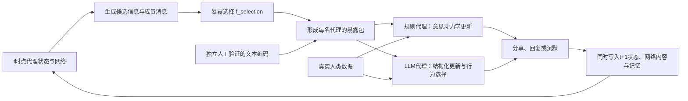

# Paper 1：HiSim 混合 ABM 方法拆解

## Mou、Wei 与 Huang（2024）对本项目的方法含义

> 文件性质：Paper 1 方法工作稿。本文档拆解 HiSim 的混合 ABM 架构、意见更新函数、文本—数值接口、校准方式及其代码实现，并据此提出本项目的落地方案。本文档不修改现有正式 RP，也不把下述实现建议视为已确认的理论构念。

## 一、文献信息与核心判断

**文献：** Mou, X., Wei, Z., & Huang, X. (2024). *Unveiling the Truth and Facilitating Change: Towards Agent-based Large-scale Social Movement Simulation*. Findings of the Association for Computational Linguistics: ACL 2024, 4789–4809. [DOI](https://doi.org/10.18653/v1/2024.findings-acl.285)；[作者代码](https://github.com/xymou/HiSim)。

**页码约定：** 下表使用 PDF 文件中的页序号；论文印刷页码从 4789 开始。

| 内容 | PDF 页 |
| --- | --- |
| 总体框架、三函数分解与两类代理 | 2–3 |
| 核心代理资料、记忆、行为与普通代理 | 4–5 |
| 自然语言到 attitude score 的接口 | 5 |
| 数据、指标、校准与主要结果 | 6–9 |
| 局限与 LLM 输出偏差 | 10 |
| BC、HK、RA、SJ、Lorenz 更新函数 | 12–14 |
| 宏观模拟算法 | 17 |
| 参数表与参数解释 | 19 |
| 温度分析与错误分析 | 20 |

**论文使用的原始术语：** `hybrid framework for social media user simulation`、`LLM-empowered core users`、`ordinary users supported by deductive agent-based models`、`opinion dynamics`、`attitude score`。

**本文献的准确定位：** HiSim 是一种混合社会模拟架构。它让少量活跃且有影响力的核心用户由 LLM 生成文本行为，让大量普通用户按照经典意见动力学规则更新连续态度。核心用户与普通用户的划分主要服务于行为表达能力与计算成本之间的平衡。论文没有证明两类节点对应两种稳定的人类心理类型。

**对 Paper 1 最关键的贡献：** HiSim 把一次群体意见演化拆成三个函数：谁进入成员的信息集合、成员收到什么消息、成员如何更新意见。这个分解能把 Paper 1 的 SQ1 与 SQ2 接起来：

$$
\text{信息生成}
\rightarrow f_{\text{selection}}
\rightarrow f_{\text{message}}
\rightarrow f_{\text{update}}
\rightarrow \text{群体意见分布}
$$

**需要立即保留的批判结论：** HiSim 提供了可运行的混合框架，但它还没有完成本项目所需的“自然语言信息—双向代理交互—人类意见更新”识别。尤其是，论文把核心用户发布的文本直接转换为该用户的态度分数，普通节点也无法把自己的信息反馈给 LLM 节点。因此，本项目可以继承其函数分解与工程骨架，不能直接继承它的状态测量和耦合方式。

---

## 二、HiSim 究竟模拟了什么

### 1. 研究对象和分析层级

| 检查项 | HiSim 的做法 | 边界 |
| --- | --- | --- |
| 研究对象 | 社会运动触发事件之后的社交媒体用户反应 | 研究的是公开表达与群体态度轨迹，不能自动推广到私下信念 |
| 个体状态 | $a_{i,t}\in[-1,1]$ | 正负号表示支持或反对，绝对值表示强度 |
| 个体行为 | 发布、转发、回复、点赞、沉默 | 行为输出与潜在态度在实现中被紧密绑定 |
| 群体结果 | 平均态度、态度分散程度、时间序列轨迹 | 用于描述群体意见演化 |
| 技术层 | GPT-3.5-Turbo-0613 驱动核心用户 | 温度、提示、记忆和可见页面均会改变系统结果 |
| 社会层 | Twitter 式可见网络、时间线、离线新闻 | 普通代理的更新代码仍主要从全体代理中抽样 |

论文使用 `attitude` 和 `opinion dynamics`。这里的状态适合表示“对某个具体政策或运动的支持—反对位置”。它没有单独建模事实命题的主观可信度，也没有把政策支持、事实信念、表达行为和情绪分成不同状态。

### 2. 两类代理

**LLM 核心用户：** 论文从每个事件的真实用户中选取 100 名高影响用户和 200 名活跃用户，共 300 个核心节点。代理资料包括人口属性、政治倾向、账户类型、活跃度、影响力、传播角色、历史推文和事件记忆。LLM 根据资料、新闻、记忆、时间线与通知选择行为并生成文本。

**规则普通用户：** 每个事件另抽取 700 名普通用户。其初始态度来自真实推文，后续意见由 BC、HK、RA、SJ 或 Lorenz 模型更新。

**这项划分的模型位置：** 它属于计算架构与节点实现方式。LLM 核心用户负责生成较丰富的文本行为，规则代理承担大规模意见演化。把某个节点设为 LLM 代理，并不能单独说明该节点更接近真实人类。

---

## 三、三个函数：HiSim 最值得继承的部分

论文把个体 $i$ 在 $t$ 时点的态度变化写为：

$$
\Delta a_{i,t}
=a_{i,t+1}-a_{i,t}
=f_{\text{update}}(a_{i,t},M_{i,t}),
$$

其中：

$$
M_{i,t}=\{m_{j,t}\mid j\in J_{i,t}\}.
$$

三个函数分别是：

1. **Selection function，$f_{\text{selection}}$：** 决定哪些来源 $j$ 进入 $J_{i,t}$。它回答“成员实际接触谁的信息”。
2. **Message function，$f_{\text{message}}$：** 决定来源状态如何形成消息 $m_{j,t}$。经典数值模型通常令 $m_{j,t}=a_{j,t}$。
3. **Update function，$f_{\text{update}}$：** 决定收到消息后，成员的意见状态如何变化。

这个分解对 Paper 1 的方法价值很明确：

| Paper 1 问题 | 对应函数 | 可以观察的对象 |
| --- | --- | --- |
| LLM 改变成员看到什么 | $f_{\text{selection}}$ | 实际暴露的回答、主张、来源、论据 |
| LLM 和成员传播什么 | $f_{\text{message}}$ | 原始文本、分享行为、传播路径 |
| 信息如何进入意见变化 | $f_{\text{update}}$ | 前后测意见、接受程度、置信度、更新幅度 |
| 群体分布如何演化 | 三个函数的迭代结果 | 均值、方差、分位数、聚类、双峰性、轨迹 |

网络邻接关系与实际信息选择需要分开。网络决定成员可能接触的对象，$f_{\text{selection}}$ 决定本轮真正进入其暴露集合的消息。两者合并后，网络效应与注意选择效应将无法区分。

---

## 四、五种意见更新函数

以下先列论文的理论形式，再列作者代码的实际实现。论文附录与公开代码之间存在差异，采用任何函数前都需要单元测试。

### 1. BC：Deffuant bounded-confidence model

**来源：** Deffuant et al.（2000）。

**理论含义：** 个体随机遇到一名意见来源。两者意见距离小于置信界限 $\varepsilon_i$ 时，个体向来源靠近；距离超过界限时不更新。

$$
a_{i,t+1}
=a_{i,t}
+\alpha_i\mathbf{1}(|a_{j,t}-a_{i,t}|<\varepsilon_i)
(a_{j,t}-a_{i,t}).
$$

**参数：** $\alpha_i$ 是影响强度；$\varepsilon_i$ 是可接受意见距离。

**经验对应：** 受试者在暴露于不同立场距离的信息后产生的意见变化，可用于估计距离阈值和更新幅度。

**适用性：** 结构最简单，参数较容易识别。硬阈值会在 $\varepsilon_i$ 两侧产生不连续行为，可能夸大聚类。

### 2. HK：Hegselmann–Krause bounded-confidence model

**来源：** Hegselmann and Krause（2002）。

**理论含义：** 个体同时考虑置信范围内的多名成员，并向这些成员的平均意见移动。

作者代码实现可以化简为：

$$
a_{i,t+1}
=\frac{a_{i,t}+\sum_{j\in J_{i,t}}a_{j,t}}
{|J_{i,t}|+1},
\qquad
J_{i,t}=\{j:|a_{j,t}-a_{i,t}|<\varepsilon_i\}.
$$

**适用性：** 适合一轮接触多条信息的环境。它把置信范围内的来源近似等权处理，无法直接表达来源可信度、论据质量或分享者身份差异。

**复现警告：** PDF 附录把差值印为 $(a_i-a_j)$，作者代码使用 $(a_j-a_i)$。代码方向才与同化定义一致。附录参数表为 HK 报告了 `alpha`，代码中的 HK 更新没有使用该参数。

### 3. RA：Relative Agreement model

**来源：** Deffuant et al.（2002）。

**理论含义：** 每个代理同时具有意见 $a_{i,t}$ 和不确定性 $u_{i,t}$，二者形成意见区间 $[a_i-u_i,a_i+u_i]$。两个区间的相对重叠越大，来源对目标的影响越强。

令：

$$
h_{ij,t}
=\min(a_i+u_i,a_j+u_j)
-\max(a_i-u_i,a_j-u_j),
$$

$$
r_{ij,t}
=
\begin{cases}
h_{ij,t}/u_{j,t}-1, & h_{ij,t}/u_{j,t}>1,\\
0, & \text{otherwise}.
\end{cases}
$$

作者代码的意见更新为：

$$
a_{i,t+1}=a_{i,t}+\alpha_i r_{ij,t}(a_{j,t}-a_{i,t}),
$$

不确定性也以同一权重更新：

$$
u_{i,t+1}=u_{i,t}+\alpha_i r_{ij,t}(u_{j,t}-u_{i,t}).
$$

**适用性：** 如果人类校准实验同时测量意见位置和主观确定程度，RA 能表达“高确定来源对低确定成员影响更大”一类过程。

**复现警告：** PDF 附录的意见差值方向与作者代码相反。项目中应以原始 RA 定义、作者代码和单元测试三方核对后的版本为准。

### 4. SJ：Social Judgment model

**来源：** Jager and Amblard（2005）。

**理论含义：** 近距离意见引发同化，远距离意见可能引发排斥，中间区域不更新。令 $d_{ij,t}=|a_{j,t}-a_{i,t}|$：

$$
\Delta a_{i,t}=
\begin{cases}
\alpha_i(a_{j,t}-a_{i,t}), & d_{ij,t}<u_i,\\
-\alpha_i(a_{j,t}-a_{i,t}), & d_{ij,t}>t_i,\\
0, & u_i\le d_{ij,t}\le t_i.
\end{cases}
$$

$u_i$ 是接受阈值，$t_i$ 是拒绝阈值。

**理论价值：** SJ 能在同一分析单位下区分两种竞争性预测：相近信息推动收敛，远距信息推动分化。它与本项目“共同模型输入导致收敛”以及“用户条件化信息导致分化”的理论张力直接相关。

**使用条件：** 排斥更新需要由人类数据支持。若实验只观察到不接受，未观察到反方向移动，SJ 的 repulsion 项不能作为主模型机制。

**代码警告：** 作者代码在接受区间中先把 `sim` 设为 $(a_j-a_i)$，随后再次乘以 $(a_j-a_i)$，形成平方项。该实现会丢失靠近方向，与论文给出的指示函数形式不一致，不能直接复制。

### 5. Lorenz model

**来源：** Lorenz et al.（2021）。

论文形式结合了同化、强化、相似性偏差、极化因子和来源可信度：

$$
\Delta a_{i,t}
=\alpha_i s(i,j)\,pol(a_{i,t})\,sim(a_{i,t},m_{j,t})
\left[\rho\,asm(a_{i,t},m_{j,t})+(1-\rho)ref(m_{j,t})\right],
$$

其中：

$$
pol(a)=\frac{M^2-a^2}{M^2},
\qquad
sim(a,m)=\frac{\lambda^k}{\lambda^k+|m-a|^k},
$$

$$
asm(a,m)=m-a,
\qquad
ref(m)=m.
$$

**适用性：** 它可以产生同化与立场强化，并允许相似性连续变化。参数多、机制重叠，容易出现不同参数组合生成相似宏观轨迹的问题。

**代码警告：** 论文公式包含来源可信度 $s(i,j)$，作者代码的实际更新式没有该项。代码使用 `tho` 表示 $\rho$。因此不能只根据论文参数表复现完整理论式。

### 6. 五种模型对本项目的选择建议

| 模型 | 能回答的问题 | 需要的人类数据 | 当前建议 |
| --- | --- | --- | --- |
| BC | 立场距离是否决定接受 | 多个距离条件下的前后测意见 | 可作透明基线 |
| HK | 多条相近信息是否产生平均化 | 多信息暴露条件 | 可作多暴露基线，先修正公式与调度 |
| RA | 意见确定程度是否改变影响 | 意见位置与置信度的联合前后测 | 收集置信度后再用 |
| SJ | 远距信息导致不更新还是反向移动 | 能识别拒绝区间与反向变化的实验 | 适合竞争机制检验，不宜无证据预设排斥 |
| Lorenz | 同化与立场强化如何共同出现 | 足以识别多参数的重复观测 | 适合稳健性分析，不宜直接作最简主模型 |

**当前方法判断：** Paper 1 正式 RP 中的锚定更新式仍可作为主模型的最小骨架：

$$
x_{i,t+1}
=x_{i,t}
+\lambda_i a_{i,t}(s_{i,t}-x_{i,t}).
$$

它的优势在于 $\lambda_i$、$a_{i,t}$ 与信息立场 $s_{i,t}$ 均能通过人类实验估计。SJ 用于检验远距信息是否产生排斥，RA 用于检验不确定性是否需要进入状态，Lorenz 用于考察结论对更丰富动力学的敏感性。最终主模型需要由参数恢复和保留议题预测决定。

---

## 五、HiSim 如何把自然语言转成意见状态

### 1. 论文的转换链

LLM 核心代理先生成自然语言反应。随后：

1. 规则或 GPT-3.5 把文本标为 `Support`、`Neutral` 或 `Oppose`；
2. TextBlob 计算文本情感极性绝对值；
3. 支持赋正号，反对赋负号；
4. 该数值被写入核心代理的 `attitude score`；
5. 普通代理把这个数值当作来源意见，进入数值更新函数。

形式上可以写成：

$$
\text{generated text}_{i,t}
\xrightarrow{\text{stance label + sentiment}}
\widehat a_{i,t}
\xrightarrow{\text{mirror overwrite}}
a_{i,t}.
$$

### 2. 这里隐藏的测量问题

这条链把“本轮公开表达”当成“代理本轮内部态度”。二者在经验研究中需要分开。以下情况会产生明显误差：

- 一条明确支持政策、但情绪词很少的文本可能得到接近 0 的 TextBlob 分数；
- 沉默在代码中被赋值为 0，并覆盖成中立态度；
- 转发或点赞可能表示传播、身份表达、批判引用或策略行为，不能稳定等同于态度变化；
- 同一个 LLM 既生成文本，又参与文本立场标注，容易形成模型内一致性；
- 输出文本随温度变化时，推断出的“态度状态”也随之变化，状态变化中混入了生成随机性。

因此，LLM 代理的潜在意见不能只由它刚生成的文本反推。较稳妥的实现是：每个 LLM 代理在调用前拥有显式数值状态，LLM 返回结构化的更新决定和行为输出；自然语言文本用于传播，数值状态用于动力学。两者均保存，后续检查表达与状态是否一致。

---

## 六、HiSim 的耦合方式及其局限

### 1. 实际耦合顺序

作者代码每轮大致执行：

1. LLM 核心代理根据时间线和新闻生成行为；
2. 所有规则代理先执行一次意见更新；
3. 再用本轮 LLM 文本推断出的态度覆盖对应的“镜像节点”；
4. 更新公开推文、记忆、时间线和通知。

这意味着普通代理本轮使用的通常是核心代理上一轮的镜像态度。LLM 核心代理能通过其他 LLM 节点生成的文本获得社会信息，规则普通代理没有自然语言输出通道，无法以同等方式反馈到核心代理。论文也明确说明忽略普通用户对核心用户的影响。

### 2. 对本项目的直接后果

本项目计划让部分节点由 LLM 模拟人类思考和传播，其余节点按意见动力学更新。这个设计要求双向接口：

$$
\text{LLM代理文本}
\rightarrow \text{结构化编码}
\rightarrow \text{规则代理更新}
$$

以及：

$$
\text{规则代理状态与分享行为}
\rightarrow \text{可读暴露包}
\rightarrow \text{LLM代理更新与行动}.
$$

第二条在 HiSim 中基本缺失。若不补足，所谓混合群体仍是“LLM 节点驱动、规则节点响应”的单向系统，无法研究群体成员之间的完整信息传播与意见形成。

---

## 七、数据、校准与验证：论文做到了哪一步

### 1. 数据与规模

论文使用 Metoo、Roe 和 BLM 三类事件，每个事件构造 1,000 个用户，其中 300 个核心用户、700 个普通用户。网络、初始态度、历史推文和触发新闻来自真实数据。每个事件运行 14 个时间步。

### 2. 微观验证

论文比较模拟行为与真实用户行为，指标包括：

- 立场分类：accuracy、F1、MAE；
- 内容类型：accuracy、F1、语义相似度；
- 行为类型：发布与转发的 accuracy、F1。

这些指标检验“给定人物资料和情境时，LLM 能否复现一次公开反应”。它们没有直接检验同一人的潜在意见在多轮暴露后的变化。

### 3. 宏观验证

宏观层比较：

- `Bias`：平均态度相对中立点的偏离；
- `Diversity`：态度分散程度；
- 平均态度时间序列的 DTW 与 Pearson correlation。

混合模型在多数时间序列指标上优于纯规则 ABM，但并非每个数据集、每种函数和每项指标都改善。论文还发现混合模型常产生更大的正向态度偏差，作者将其联系到 LLM 倾向生成明确、支持性的表达。

### 4. 参数校准

作者先在 E1/P1 数据上对纯 ABM 做参数遍历，以 $\Delta Bias$ 和 $\Delta Diversity$ 选择参数，再把同一参数放入混合系统，并在 E2/P2 上验证。这个做法节省了 LLM 调用成本，但存在一个转移假设：纯规则系统中合适的更新参数，也适合加入 LLM 核心节点后的系统。论文没有单独检验这一假设。

### 5. 随机性处理

主实验使用 GPT-3.5-Turbo-0613、temperature 0、max tokens 256。附录把 temperature 改为 1 后，多项宏观结果发生明显变化。论文因此表明：LLM 采样设置会改变系统结果，需要单独报告并进入敏感性分析。

论文表 3 说明结果为 3 次运行均值，附录 C.2 又说明混合模型固定一次核心用户生成结果后运行 10 次。这一处报告口径需要复现时向作者代码或运行日志核对。固定一次 LLM 内容再重复规则 ABM，只估计规则层随机性，不能估计 LLM 生成层的不确定性。

---

## 八、论文与公开代码的复现审计

代码核对基于作者公开仓库主分支提交 `01360e882751abbd5158101ca840dfaa18c4520c`。以下差异会改变模拟结果：

| 项目 | 论文或注释 | 公开代码 | 对本项目的处理 |
| --- | --- | --- | --- |
| HK 更新方向 | PDF 印为 $(a_i-a_j)$ | 使用 $(a_j-a_i)$ | 采用同化方向，并写方向性单元测试 |
| HK 的 $\alpha$ | 参数表报告 `alpha` | 更新中没有使用 `alpha` | 明确是否保留社会影响强度，不能沿用表值 |
| RA 更新方向 | PDF 印为 $(a_i-a_j)$ | 使用 $(a_j-a_i)$ | 按原始 RA 定义核对 |
| SJ 接受区间 | 论文是指示函数乘意见差 | 代码形成意见差的平方项 | 重写并测试，不能复制现有实现 |
| Lorenz 来源可信度 | 公式包含 $s(i,j)$ | 代码未使用 $s(i,j)$ | 若保留该项，必须有经验测量；否则从模型声明中删除 |
| Diversity | 文中说明为标准差 | `np.var` 计算方差 | 预注册时固定一个定义，建议同时报告 SD 与 variance |
| `concurrent` 调度 | 名称暗示并行/同时 | 映射到 Mesa `BaseScheduler`，按固定顺序逐个更新 | 主分析使用同步更新，并把异步顺序作为敏感性检查 |
| 普通代理选源 | 叙述强调真实网络 | 五类规则代码主要从全部代理中选择 | 只从可见邻居与实际暴露集合中选择 |
| LLM 沉默 | 行为之一 | `Silence` 被赋态度 0 | 沉默记录为缺失表达，保留先前潜在状态 |
| 核心节点状态 | LLM 输出后更新态度 | 文本经立场与情感编码后覆盖镜像状态 | 显式维护状态，文本只作为行为和消息 |

这组差异说明，论文的公式、参数表、文字说明和代码必须四方对照。作者代码可作为实现证据，不能替代理论定义与人类校准。

---

## 九、Paper 1 的混合 ABM 落地方案

以下内容是本项目的实现建议，仍需预实验确认；其中的变量名是程序字段，不作为新增理论构念。

### 1. 三种 LLM 角色必须分离

| 角色 | 任务 | 主要风险 | 处理原则 |
| --- | --- | --- | --- |
| 被研究的 LLM 信息源 | 生成成员在研究情境中获得的 AI 回答 | 输出同质性、个性化、路由影响 | 它是研究处理的一部分 |
| 模拟人类的 LLM 代理 | 根据人类资料、当前状态、记忆和暴露决定更新、分享与表达 | 把模型偏好误当成人类行为 | 用真实人类转移数据验证 |
| 文本编码器 | 把自然语言编码为立场、主张、来源及可核查字段 | 编码器与生成器共享偏误 | 与前两者分离，并由人工盲审验证 |

同一基础模型同时承担三种角色时，模型生成偏好、代理决策偏好和测量偏好会互相强化。最低要求是分别记录角色、模型版本、提示、温度与调用时间，并用独立人工编码估计测量误差。

### 2. 代理状态

每个代理至少保留：

$$
S_{i,t}=\{x_{i,t},u_{i,t},H_{i,t},E_{i,t},Y_{i,t}\}.
$$

这里：

- $x_{i,t}$：对当前政策议题的意见位置；
- $u_{i,t}$：意见确定程度，只有在采用 RA 或人类数据支持其作用时进入更新函数；
- $H_{i,t}$：过去状态、收到的信息与既往行为日志；
- $E_{i,t}$：本轮实际暴露的信息集合；
- $Y_{i,t}$：本轮公开行为，如分享、回复、表达或沉默。

若研究材料包含可验证事实命题，再增加该命题的主观概率。事实可信度与政策支持必须分别测量。

### 3. 消息表示

HiSim 的 $m_{j,t}=a_{j,t}$ 过度压缩自然语言。本项目可把每条消息保存为：

$$
m_{j,t}=\{\text{raw text},\text{stance},\text{claims},\text{cited sources},
\text{expressed uncertainty},\text{sender},\text{action type}\}.
$$

这些是文本编码字段。它们让我们分别测量信息暴露、文本表达、信息分享和意见变化，避免用单一情感分数替代全部过程。

### 4. 双向一轮运行顺序

建议每轮采用同步快照，所有代理根据 $t$ 时点状态作出决定，统一写入 $t+1$：

规则代理的更新可以写为：

$$
x_{i,t+1}
=\operatorname{clip}
\left[x_{i,t}+f_{\text{update}}
\left(x_{i,t},\operatorname{Enc}(E_{i,t});\theta_i\right)\right].
$$

LLM 代理的实现可以写为：

$$
r_{i,t}=LLM_{\text{sim}}
(P_i,S_{i,t},\operatorname{Pack}(E_{i,t})),
$$

$$
(x_{i,t+1},u_{i,t+1},Y_{i,t})
=\operatorname{Parse}(r_{i,t}).
$$

$P_i$ 是由真实人类数据构造的代理资料；`Pack` 把规则代理的状态与消息转成 LLM 可读的暴露材料；`Parse` 只接受预先规定的结构化字段。原始回答必须同步保存，便于人工检查。

### 5. LLM 节点如何抽样

HiSim 按影响力和活跃度选择核心节点，这适合模拟社交媒体意见领袖。本项目需要先说明为什么某些人类节点需要 LLM 表达能力：

- 若研究关注高影响节点的丰富表达，可按影响力或网络中心性选择；
- 若研究关注不同人群的认知与传播异质性，可按真实样本特征分层抽取；
- 若只检验代理实现方式的影响，可在分层内随机决定哪些节点由 LLM 驱动。

无论采用哪一种，初始意见、人口特征与网络位置需要在不同反事实运行间保持一致。LLM 节点比例和位置属于模型输入，不能在看到宏观结果后挑选。

### 6. 人类数据怎样进入模型

真实问卷可以完成两类工作，它们不能互相替代：

1. **初始化：** 估计初始意见、置信度、人口特征、媒介使用与网络位置的联合分布；
2. **更新校准：** 在控制信息内容、来源、立场距离和重复暴露的条件下，观察真实参与者的意见变化与分享选择。

只用问卷画像生成 persona，只能支持人口初始化。要声称代理模拟了人类意见更新，还需要前后测转移数据。参数应在一部分议题上估计，在保留议题上检验方向、幅度与分布预测。

---

## 十、最小可审计实现

### 1. 模型组件

| 组件 | 最低要求 |
| --- | --- |
| Population initializer | 从真实人类样本联合抽样，不独立拼接人口变量 |
| Network | 保存可能连接与实际暴露两层记录 |
| Studied LLM source | 固定模型版本、提示、采样参数与回答库 |
| Rule-agent kernel | 一个主更新式，加预先指定的竞争规则 |
| LLM-agent kernel | 显式数值状态、结构化输出、完整原始文本 |
| Text encoder | 人工编码标准、独立模型编码、置信度和分歧记录 |
| Scheduler | 同步更新为主，异步顺序作敏感性检查 |
| Logger | 记录每条消息从生成、暴露、接受、分享到状态变化的全路径 |

### 2. 必须做的单元测试

- 当 $a_j>a_i$ 且处于接受区间时，BC、HK、RA 的更新方向应为正；
- 当 $a_j<a_i$ 且处于接受区间时，更新方向应为负；
- SJ 在接受区间向来源靠近，在拒绝区间远离来源，在中间区间保持不变；
- 沉默不得自动把潜在意见改为 0；
- 同步更新中，代理顺序变化不应改变结果；
- 文本编码器对语义相同、情绪词不同的政策表达应给出接近的立场编码；
- 规则代理的信息必须能够进入 LLM 代理下一轮暴露；
- 固定全部状态与随机种子时，模型运行可重复；改变 LLM 种子时，生成层不确定性能够单独估计。

### 3. 校准与验证顺序

1. 用人类数据估计初始化分布；
2. 用单轮受控暴露数据估计更新和分享参数；
3. 做参数恢复，检查不同参数能否被区分；
4. 在保留议题上检验微观意见转移与分享行为；
5. 再比较宏观均值、方差、聚类、双峰性和时间轨迹；
6. 分别改变网络、调度、更新函数、LLM 温度和 LLM 节点比例，报告敏感性；
7. 只有通过人类保留样本验证的版本，才进入大规模反事实模拟。

---

## 十一、这篇论文能够支持与不能支持的主张

### 可以支持

- LLM 代理与经典意见动力学代理可以被放入同一 ABM 框架；
- 少量 LLM 节点与大量规则节点能够降低全 LLM 模拟的调用成本；
- $f_{\text{selection}}$、$f_{\text{message}}$ 和 $f_{\text{update}}$ 提供了清晰的方法分解；
- 真实网络、真实初始状态和真实历史文本可以用于初始化代理；
- 微观行为对齐与宏观时间序列都需要验证；
- LLM 温度会显著改变宏观模拟结果。

### 需要修改后才能使用

- LLM 文本到意见状态的转换；
- LLM 节点与规则节点之间的单向耦合；
- 从全体代理随机选源的普通节点更新；
- 纯 ABM 参数向混合系统的直接迁移；
- 用一次 LLM 生成结果代表生成层不确定性；
- 将公开表达、情感强度和潜在意见合并为一个分数。

### 不能由该论文推出

- LLM 核心代理已经复现真实人类的内部思考；
- 混合模型在所有指标上都比传统 ABM 更接近现实；
- 一千节点、十四轮的结果已经验证百万级长期社会仿真；
- 内容消费与内容生产相似度上升已经证明真实人类陷入信息茧房；
- 模拟得到的群体收敛、极化或偏移等同于现实世界的因果效应。

---

## 十二、对 Paper 1 的最终方法裁决

**裁决：保留 HiSim 作为混合 ABM 的直接方法先例，大修其状态表示、双向接口和校准方式。**

Paper 1 可以采用以下结构：

$$
\text{真实人类数据初始化与校准}
+\text{部分 LLM 人类代理}
+\text{大量规则代理}
+\text{被研究的 LLM 信息源}
+\text{双向传播网络}.
$$

最应继承的是三个函数的分解与微观—宏观验证思路。最需要避免的是用生成文本反推代理内部态度、让普通代理只能被动接受 LLM 节点影响，以及未经人类转移数据校准便解释长期群体涌现。

当前仍需通过预实验决定的事项只有三项：主更新函数、LLM 节点的抽样规则、LLM 代理结构化输出中哪些状态能够被真实人类数据验证。这三项确认后，混合 ABM 才进入正式编码阶段。

---

## 参考文献

- Deffuant, G., Neau, D., Amblard, F., & Weisbuch, G. (2000). Mixing beliefs among interacting agents. *Advances in Complex Systems, 3*(1–4), 87–98.
- Deffuant, G., Amblard, F., Weisbuch, G., & Faure, T. (2002). How can extremism prevail? A study based on the relative agreement interaction model. *Journal of Artificial Societies and Social Simulation, 5*(4).
- Hegselmann, R., & Krause, U. (2002). Opinion dynamics and bounded confidence: Models, analysis and simulation. *Journal of Artificial Societies and Social Simulation, 5*(3).
- Jager, W., & Amblard, F. (2005). Multiple attitude dynamics in large populations. In *Agent 2005 Conference on Generative Social Processes, Models, and Mechanisms*.
- Lorenz, J., Neumann, M., & Schröder, T. (2021). Individual attitude change and societal dynamics: Computational experiments with psychological theories. *Psychological Review, 128*(4), 623–642. https://doi.org/10.1037/rev0000291
- Mou, X., Wei, Z., & Huang, X. (2024). Unveiling the truth and facilitating change: Towards agent-based large-scale social movement simulation. *Findings of ACL 2024*, 4789–4809. https://doi.org/10.18653/v1/2024.findings-acl.285
