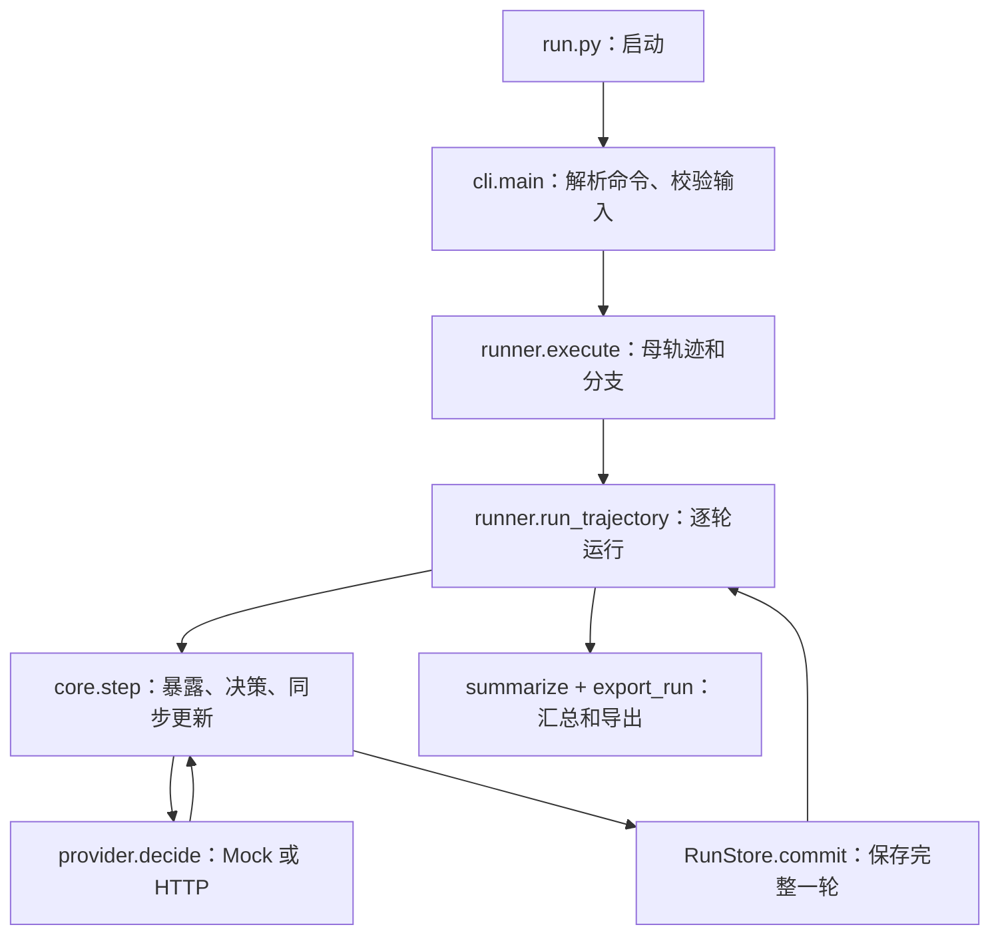

# rumor_llm_study 项目代码拆解与接手指南

日期：2026-10-13。对象：独立子项目 `G:\ABM_INFO\TESTPROJECT\rumor_llm_study`。

本文保存并整理本次对话中的代码拆解，依据本地实际代码。参数名称表示程序设定，不等于已获得文献或经验验证的构念。没有改变研究设定或生产代码。

相关文件：[架构比较](ARCHITECTURE_COMPARISON_20261013.md)、[代码分析与离线运行记录](verification/CODE_REVIEW_20261013.md)。

## 1. 项目是什么，main 在哪里

这是一个 Python 命令行驱动、按离散轮次同步更新的 Agent 仿真程序。网络、信息流、个体状态、实验分支和存储均自行实现；核心仿真不依赖 Mesa、AnyLogic 或 LangChain。LLM 是其中可替换的个体决策器。

先抓住三个文件：`cli.py` 决定运行什么，`runner.py` 决定如何组织实验，`core.py` 决定模拟世界怎样变化。

启动入口：[run.py](run.py)。它把 `src` 加入模块搜索路径，再调用真正的主函数：[cli.py 的 main()](src/rumor_sim/cli.py)。

```python
sys.path.insert(0, str(Path(__file__).resolve().parent / "src"))
from rumor_sim.cli import main

if __name__ == "__main__":
    raise SystemExit(main())
```

安装为包后，`pyproject.toml` 注册的 `rumor-study` 命令也指向 `rumor_sim.cli:main`。Windows 的两个 `.cmd` 经 `start.ps1` 找到 Python 后，仍进入这些 Python 程序。



## 2. 目录结构

```text
rumor_llm_study/
├─ run.py                   启动入口
├─ start.ps1                Windows 启动脚本
├─ test_all.py              测试入口
├─ pyproject.toml           包定义、Python 版本、命令注册
├─ config/
│  ├─ research.json         582 人的当前配置
│  └─ smoke.json            10 人工程测试配置
├─ src/rumor_sim/
│  ├─ cli.py                命令行入口
│  ├─ config.py             配置模板、校验、规模估算
│  ├─ import_data.py        表格导入和画像处理
│  ├─ runner.py             实验调度
│  ├─ core.py               模拟核心
│  ├─ provider.py           决策器、提示词、请求、缓存和预算
│  └─ storage.py            快照、恢复、导出
├─ data/imported/           转换后的事件和画像
├─ tests/                   自动测试
├─ tools/                   API 探测、交付检查和打包工具
├─ verification/            验证报告
└─ outputs/                 运行输出
```

Python 要求为 3.11 或以上。核心仿真使用标准库；重新导入 Excel 才需要 `openpyxl`、`xlrd`。本机普通 `python` 指向 WindowsApps 别名，上次运行使用 Codex 随附 Python；现有 `start.ps1` 会优先寻找它。

## 3. 架构与模块职责

这是以函数处理状态字典的实现。没有给每个人建立带独立循环的 Agent 类；全部个体状态在一个字典中，由 `step()` 推进。

```python
result = core.step(state, config, event, decide)
next_state = result["state"]
```

`decide` 作为函数传入，因此核心规则不需要知道后面是 Mock 还是远程模型。核心函数自身不直接执行 HTTP 或文件操作，但会调用注入的决策函数；因此不能把整个 `step()` 理解为绝对无外部副作用的纯函数。

| 模块 | 关键入口 | 职责 |
|---|---|---|
| [cli.py](src/rumor_sim/cli.py) | `parser()`、`main()` | 解析命令，读取配置与事件，选择 provider |
| [config.py](src/rumor_sim/config.py) | `validate_config()`、`validate_event()`、`estimate()` | 规则校验、输入检查、运行规模估算 |
| [import_data.py](src/rumor_sim/import_data.py) | `import_directory()`、`sample_donor_profiles()` | 表格转换、去重、字段筛选、画像抽样 |
| [runner.py](src/rumor_sim/runner.py) | `execute()`、`run_trajectory()` | 初始化、母轨迹、干预分支、状态管理 |
| [core.py](src/rumor_sim/core.py) | `initialize()`、`build_feed()`、`step()`、`summarize()` | 网络、暴露、同步更新、传播、指标 |
| [provider.py](src/rumor_sim/provider.py) | `MockDecisionProvider`、`HTTPDecisionProvider` | 六字段决策、输出校验、缓存、预算与重试 |
| [storage.py](src/rumor_sim/storage.py) | `RunStore`、`export_run()` | 原子快照、状态校验、恢复与导出 |

同步更新不等于并发调用：当前代码逐个调用决策器，但先收集完整一轮决策，再统一更新所有状态。

## 4. 四种主要数据对象

| 对象 | 内容 | 是否随轮次变化 |
|---|---|---|
| `config` | 人数、网络、读取规则、时间、模型参数 | 一次运行中固定 |
| `event` | 原始主张、源帖、纠正文本、来源说明 | 一次运行中固定 |
| `state` | 全体 Agent、帖子、轮次、累计指标 | 每轮变化 |
| `view` | 一个 Agent 本轮获准看到的输入 | 每次决策构造 |

```text
state
├─ round
├─ agents
│  └─ agent_id
│     ├─ group、follows、activity
│     ├─ prior_acceptance、prior_government_trust
│     ├─ sharing_style、correction_share_willingness
│     ├─ observed_profile
│     ├─ belief_score、belief_state
│     ├─ memory、seen_posts、reposted_content_ids
│     └─ first_exposure_round、last_action
├─ posts
├─ policy
├─ pbd
├─ risk_ids、first_rejections
└─ round_metrics
```

帖子中的 `post_id` 是具体帖子编号，用于重复阅读限制；`content_id` 是根内容编号，用于限制同一人对同一根内容重复转发。转发和评论会形成新帖子，但继承根内容及来源信息。

原始资料和模拟状态分开。真实画像只将粉丝数、关注数、累计发博数交给模型；真实账户关注数不会决定生成网络的边数。源帖文本也是输入；历史评论和转发文字不直接作为 Agent 的初始记忆、信念或信任。

## 5. 一轮模拟的完整过程

核心是 `core.step()`：

1. 计算下一轮编号，冻结上一轮状态并建立副本。
2. 若到达 `T_G`，生成纠正帖，并确定这一轮直接投送。
3. 根据个人活跃概率决定是否自然浏览。
4. 根据关注关系、推荐概率、帖龄、阅读次数和间隔形成实际暴露。
5. 直接投送可以让自然不活跃的人仍然收到一条信息。
6. 没有任何信息的人跳过模型调用，保留原信念。
7. 为每个有信息的人构造 `view`，收集并校验全部决策。
8. 全部成功后统一更新信念、阅读历史和记忆，并生成评论或转发帖。
9. 新用户帖子下一轮可见；记录本轮指标并保存完整快照。

A 第 10 轮发布的评论，B 最早在第 11 轮看到。任何最终决策失败使本轮不提交；HTTP 模式已成功的回答可以缓存供恢复使用。

### 5.1 LLM 输入

`core._make_view()` 提供：政府信任、分享习惯、纠正分享倾向、公开账户计数、此前信念、最近五个实际决策轮记忆、本轮可见帖子、允许转发的帖子编号。首次暴露还提供 `prior_acceptance`。

没有把完整世界、未见帖子或未来纠正材料交给模型。输入含原始主张，但不应因此把模型训练知识的影响视为已经消除。

### 5.2 LLM 输出

| 字段 | 约束 |
|---|---|
| `belief_score` | 相信原始主张的程度，0–100 整数 |
| `action` | `silent`、`comment`、`repost` |
| `target_post_id` | 必须是本轮可见帖子；沉默时为空 |
| `public_stance` | support、oppose、uncertain；沉默时 none |
| `comment` | 评论动作 1–80 字符；其余为空 |
| `reason` | 1–40 字符的简短理由 |

谁关注谁、看到什么、何时投送由 Python 控制；看到以后怎样判断和行动由决策器返回。`activity` 是实际执行的概率；`sharing_style`、信任和分享意愿是传给模型的画像信息，没有直接对应一条硬编码的行为概率公式。

## 6. 核心参数

运行默认读取 [config/research.json](config/research.json)。`config.py` 也有生成配置的函数，但普通运行实际由 `main()` 读取 JSON。README 中关于不指定 `--config` 就使用 config.py 内置默认值的表述与 CLI 不一致。

### 6.1 人口与网络

| 参数 | 当前值 | 作用 |
|---|---|---|
| `population.n_inside / n_outside` | 82 / 500 | 两组人数 |
| `network.same_group_follows` | 8 | 每人关注 8 名同组用户 |
| `network.cross_group_follows` | 2 | 每人关注 2 名另一组用户 |
| `inside_follow_source / outside_follow_source` | true / false | 圈内额外关注源账号，圈外不关注 |
| `pre_follow_government` | false | 初始化时不关注政府账号 |
| `activity_levels` | 0.1、0.2、0.3 | 自然浏览概率 |
| `trust_levels` | 0.25、0.5、0.75 | 交给模型的信任画像 |
| `sharing_styles` | rare、sometimes、often | 交给模型的分享习惯 |
| `inside_counts / outside_counts` | 27/28/27；167/166/167 | 各档人数 |
| `willing_inside / willing_outside` | 49 / 300 | 愿意分享纠正的画像人数 |

活跃度、信任和分享习惯分别打乱，不是低活跃者必然低信任。当前网络固定，不依据实际账户关注关系重建，也没有随模拟行为改变关注边。

### 6.2 初始倾向

| 参数 | 当前值 | 作用 |
|---|---|---|
| `prior.overall_mean` | 0.579 | 全体初始倾向加权均值 |
| `grid.d_seed` | 0、0.2、0.4 | 两组初始倾向均值差 |
| `prior.within_group_offset` | 0.05 | 每组一半加、一半减 |

设圈内人数为 n_i，圈外为 n_o，N=n_i+n_o，则：

```text
圈内均值 = μ + (n_o/N) × d
圈外均值 = μ - (n_i/N) × d
个人倾向 = 所在组均值 ± 0.05
```

这保持全体加权均值 μ 和两组差 d。初始化时 `belief_score=None`、`belief_state=unaware`；倾向只在首次暴露时作为模型输入，不直接成为程序指定的信念分数。

### 6.3 信息流

| 参数 | 当前值 | 作用 |
|---|---|---|
| `following_slots` | 1 | 活跃者最多读一条关注来源帖子 |
| `recommendation_probability` | 0.1 | 开启推荐槽位概率，不是逐帖推荐概率 |
| `recommendation_slots` | 1 | 最多一条非关注来源帖子 |
| `direct_extra_slots` | 1 | 干预轮额外投送槽位 |
| `post_ttl_rounds` | 40 | 帖龄必须小于 40 轮 |
| `recency_half_life_rounds` | 5 | 抽取权重为 2^(-帖龄/5) |
| `max_reads_per_post` | 3 | 同一具体帖子最多读三次 |
| `repeat_gap_rounds` | 5 | 同帖重复阅读至少隔五轮 |
| `max_reposts_per_content` | 1 | 同一人对同一根内容只转发一次 |
| `new_user_post_delay` | 1 | 用户新帖下一轮可见 |
| `memory_decision_rounds` | 5 | 最近五个实际决策轮，非最近五个日历轮 |

普通信息流最多两条，干预对象当轮最多三条，但无候选时槽位可为空。政府原帖为 `direct_only`，不进入普通关注或推荐候选；后续用户转发、评论才可进入常规传播。

### 6.4 时间和干预

| 参数 | 当前值 | 作用 |
|---|---|---|
| `government_round` / `--tg` | 10、20、30、40、50 | 干预轮 |
| `targeting` | inside、random、outside | 从圈内、全体或圈外抽取 |
| `credibility` / `--gt` | 0.2、0.6、1.0 | 过去十条中 2/6/10 条准确的虚拟来源线索 |
| `direct_unique_users` | 40 | 直接投送人数 |
| `direct_delivery_rounds` | 1 | 只投送一轮 |
| `pb_checkpoint_round` | 5 | 冻结接受比例差 |
| `last_round` | 80 | 共同终点 |
| `followup_max_elapsed` | 30 | 首次拒绝观察窗口 |
| `grid.seeds` | 1、2、3 | 程序随机设置 |

gt=0.6 不会将个体信任直接改为 0.6，也不表示 60% 的人接受纠正，只改变来源描述。同一事件、seed、干预时间和定向方式下，不同 gt 使用同一批投送对象；对象抽取不以当前信念为筛选条件。

### 6.5 模型请求

| 参数 | 本地配置值 |
|---|---|
| `llm.model` | deepseek-v4-flash |
| `llm.base_url` | https://api.zetatechs.com/v1 |
| `temperature / top_p` | 0.7 / 0.8 |
| `max_output_tokens` | 384 |
| `timeout_seconds` | 90 |
| `max_retries` | 2，即最多三次请求 |
| `max_api_requests` | 20，输出目录的累计请求预算 |
| `api_key_env` | RUMOR_LLM_API_KEY |

这是本地配置，不代表本次重新核验远程服务。20 次请求不是 20 轮，也通常不足以完成整条轨迹。HTTP 运行必须显式指定请求上限；失败和重试也计入。401/403 及重定向停止自动重试，不静默换成 Mock。

## 7. 母轨迹和分支调度

每个事件、d_seed、seed 组合先运行无干预母轨迹到第 80 轮，再从干预前一轮末快照分支：

```text
母轨迹：0 → 1 → … → 80
T_G=10：第 9 轮末快照  → 第 10–80 轮
T_G=20：第19轮末快照  → 第 20–80 轮
T_G=50：第49轮末快照  → 第 50–80 轮
```

| 命令 | 范围 |
|---|---|
| `parent` | 指定组合的一条无干预轨迹 |
| `run` | 指定组合的一条母轨迹和一条干预分支 |
| `grid` | 配置中的全部组合 |
| `check` | 检查输入，不调用模型 |
| `estimate` | 估算轨迹规模与保守请求上限 |
| `import-data` | 导入原始表格 |
| `init` | 生成或校验默认配置和明确标记的合成事件 |

完整网格每事件有 3×3=9 条母轨迹；每条有 5×3×3=45 个分支，总共 414 条逻辑轨迹。分支导出包含共同前缀，但共同前缀不重复调用模型。`run` 的默认组合为 d_seed=0.2、seed=1、tg=20、inside、gt=0.6；上一轮试跑显式将 tg 改为 50。

程序随机数按事件、seed、轮次、个体及用途构造。相同 seed 不保证远程模型回答完全一致；目前请求参数没有将该程序 seed 作为模型采样 seed 发出。

## 8. 指标的代码含义

| 指标 | 实现 |
|---|---|
| 接受 / 拒绝 / 不确定 | 分数 >=60 / <=40 / 41–59 |
| 未暴露 | 尚无信念分数 |
| 接受比例 | 接受人数除以全组人数，包含未暴露者 |
| `PBd` | 第五轮圈内接受比例减圈外接受比例 |
| `risk_n` | 干预前一轮末的接受者数 |
| `updated_n` | 该集合在窗口内至少一次变为拒绝的人数 |
| `TBU_mean` | 已发生首次拒绝者的平均轮数差 |
| `censored_n` | 完整窗口内未发生首次拒绝的人数 |
| `RMST` | 完整窗口下，首次事件耗时与未发生者的窗口长度一起求均值 |

d_seed 是输入，PBd 是第五轮输出，不能混同。干预当轮首次拒绝的耗时为 0；T_G+30 轮发生为 30。未发生者也记 duration=30，但 event=0，与 event=1 区分。后来重新接受不会撤销首次拒绝。TBU_mean 只包含发生者，不能替代全体平均变化时间。

## 9. 输出、恢复与核查

```text
输出目录/
├─ study_summary.json
├─ event_summaries/
├─ provider/                    HTTP 模式的预算、缓存和审计
└─ runs/某条轨迹/
   ├─ manifest.json             输入、配置、代码等标识
   ├─ initial.json.gz
   ├─ status.json
   ├─ rounds/00050.json.gz       完整轮次状态及本轮记录
   └─ exports/
      ├─ summary.json
      ├─ states.csv
      ├─ exposures.jsonl
      ├─ decisions.jsonl
      ├─ posts.jsonl
      ├─ round_metrics.jsonl
      └─ tbu_individual.csv
```

恢复从最后完整提交轮次开始，检查日志连续性和状态哈希。相同命令与目录可恢复；改变代码、行为配置、事件等会触发匹配检查，应使用新输出目录。请求上限和超时不计入行为配置哈希，可按需调整；提高预算仍是累计上限，不会清零已使用量。

先看 summary 和 round_metrics；追查个体时依次连接 states、exposures、decisions。导出可由快照重建；这不等于已经实现一套通用的替代规则离线回放引擎。

## 10. 已执行的运行与边界

2026-10-13 完成 event_052 的 582 人、80 轮 Mock 运行：一条无干预轨迹和一条 tg=50、inside、gt=0.6 分支。61 项测试通过；修正的是离线重定向测试受系统代理影响的问题，生产模拟代码和研究配置未变。

| 实测 | 无干预 | 干预分支 |
|---|---:|---:|
| 最终接受比例 | 36.43% | 34.19% |
| 完整轨迹决策记录数 | 9090 | 9121 |
| 个体—轮次记录数 | 46560 | 46560 |

前 49 轮一致、快照哈希和导出数已核查，HTTP 请求为 0。305 份真实账户画像用于 582 个 Agent，存在模板重复。

Mock 根据 view 和 call_identity 的哈希选择 20/50/80 分数及动作；run_id 又进入 call_identity，因此分支名本身能改变 Mock 决策。上述差异不能解释成纠正效果。真实模型行为、真人行为对应和长期外推均未由这次测试验证。

运行证据：[汇总](outputs/code_review_20261013/study_summary.json)、[独立核查](outputs/code_review_20261013/audit_checks.json)、[测试日志](verification/code_review_20261013_tests.log)。

## 11. 修改位置与阅读顺序

| 目的 | 修改位置 |
|---|---|
| 人数、时间、可配置规则 | 配置 JSON，建议另存新文件 |
| 事件和画像 | event.json、profiles.jsonl |
| 提示词和输出协议 | provider.py 与对应校验 |
| 模型可见输入 | core._make_view |
| 信息选择 | core.build_feed |
| 网络初始化 | core.initialize |
| 状态更新和传播 | core.step、core._user_post |
| 实验调度 | runner.execute |
| 指标 | core.individual_tbu、core.summarize |

JSON 中的字段不全是自由参数。校验器锁定信念阈值、槽位数、转发上限、新帖延迟、部分网络标志等；改规则时需同步检查实现、校验和测试。没有任何操作会自动把这些子项目参数确认成总项目参数。

建议阅读顺序：`run.py → cli.main → runner.execute → run_trajectory → core.step → _make_view → provider.decide`，再读配置、存储和测试。

在项目根目录运行：

```powershell
python test_all.py
python run.py check --config config/research.json --event data/imported/event_052/event.json
python run.py run --config config/research.json --event data/imported/event_052/event.json --provider mock --tg 50 --output outputs/example
```

本机也可使用现有“开始离线验证.cmd”。它先运行测试，再建立新输出目录运行 Mock 示例。
